# App flow — MicroMonde

Statut : brouillon (à valider)
Couvre : US-01 … US-13 de [PRD.md](PRD.md)
Sources : code `0.3.0-beta` (`src/main.ts`, `src/ui/hud.ts`, `src/ui/panel.ts`, `src/map/map.ts`, `index.html`, `map.html`), vidéos d'essai du 19/10/2026, `Fiche Projet Micro Monde.docx`.

Les schémas distinguent le **constaté** (lu dans le code ou vu en vidéo) du **prévu** (fiche projet, pas encore codé). Les nœuds prévus portent la mention « V2 ».

Le QR du support physique mène à la **page de scan** (décision du 26/10/2026) ; la carte s'ouvre depuis le scan. Les retours observés après usage sont dans [TESTS-UTILISATEURS.md](TESTS-UTILISATEURS.md).

## 1. Carte des écrans et vues

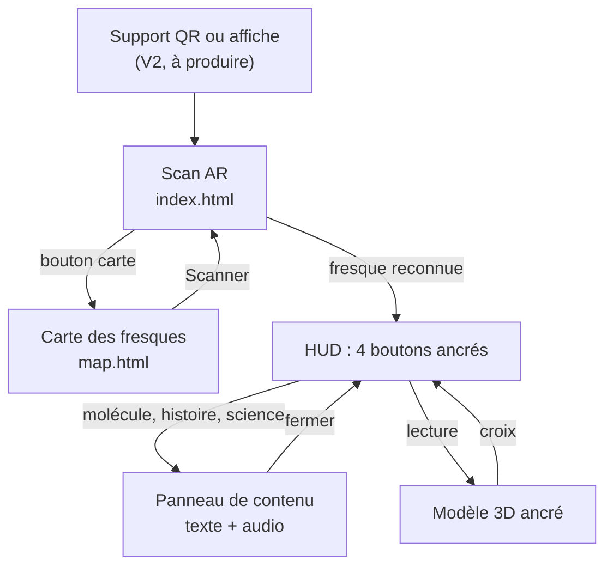

| Écran / vue | Rôle | Accès depuis |
|---|---|---|
| Carte (`map.html`) | Localise les 3 fresques, montre la position du visiteur | Bouton carte du scan |
| Popup de marqueur | Nom de la fresque + bouton « Scanner » | Touche sur un marqueur |
| Scan (`index.html`, adresse racine) | Caméra, reconnaissance de la fresque | Support QR (adresse racine) ; bouton « Scanner » de la carte |
| Chargement du moteur | Écran du moteur 8th Wall pendant l'initialisation | Ouverture du scan |
| HUD | 3 boutons de contenu ancrés sur l'image + bouton lecture au centre | Fresque reconnue |
| Panneau de contenu | Titre, texte, mention IA, crédits, bouton audio | Bouton molécule, histoire ou science |
| Modèle 3D | Animal animé, ancré dans l'espace | Bouton lecture |
| Croix de fermeture 3D | Masque le modèle | Modèle visible |

Précisions de comportement :

- Le bouton « Scanner » du popup ouvre le scan générique. La fresque est reconnue par l'image, pas par le marqueur choisi.
- Un seul panneau existe : ouvrir un autre contenu remplace le texte du panneau.
- Le modèle 3D n'apparaît jamais seul : il faut l'appui sur le bouton lecture.
- Une seule fresque est affichée à la fois ; les modèles des autres cibles sont masqués.

## 2. Parcours utilisateur

### Parcours P1 : première visite devant une fresque (US-01, US-03 à US-08)

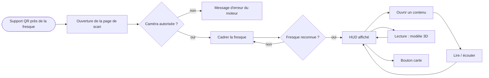

| Étape | Action utilisateur | Réponse du système | Cas d'erreur |
|---|---|---|---|
| 1 | Scanne le QR du support | Ouvre la page de scan et charge le moteur | Pas de réseau : rien ne se charge. Chargement long : écran du moteur |
| 2 | Autorise la caméra | Flux caméra plein écran | Refus : message du moteur (`RuntimeError`) |
| 3 | Cadre la fresque | Reconnaissance de l'image, HUD affiché | Image non reconnue : rien ne s'affiche. Fresque sortie du cadre : l'interface disparaît, il faut reprendre le cadre (retour de la classe) |
| 4 | Touche molécule, histoire ou science | Panneau avec texte, mention IA, crédits | Audio absent : bouton sans effet, avertissement en console |
| 5 | Touche lecture au centre | L'animal apparaît, ancré ; une croix apparaît en haut à droite | Modèle lourd pas encore chargé : la demande est gardée puis appliquée |
| 6 | Tourne autour du modèle | Le modèle reste en place (suivi de l'espace) | Suivi perdu : voir § 3 |
| 7 | Touche la croix ou le bouton carte | Masque le modèle / ouvre la carte | — |

### Parcours P2 : depuis une affiche relais, loin des fresques (US-02, US-07 ; V2)

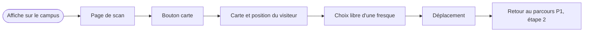

| Étape | Action utilisateur | Réponse du système | Cas d'erreur |
|---|---|---|---|
| 1 | Scanne l'affiche | Ouvre la page de scan | — |
| 2 | Touche le bouton carte | Ouvre la carte : marqueurs + point de position | Géolocalisation refusée : carte utilisable sans le point |
| 3 | Choisit une fresque | Popup avec le nom | — |
| 4 | Se déplace puis scanne | Parcours P1, étape 2 | Fresque difficile à voir depuis les étages +1 / +2 : précision de lieu prévue dans le popup (V2) |

### Parcours P3 : mode dégradé (US-12 ; V2)

Les alternatives ci-dessous sont des **pistes non décidées**, issues des supports physiques de la fiche projet.

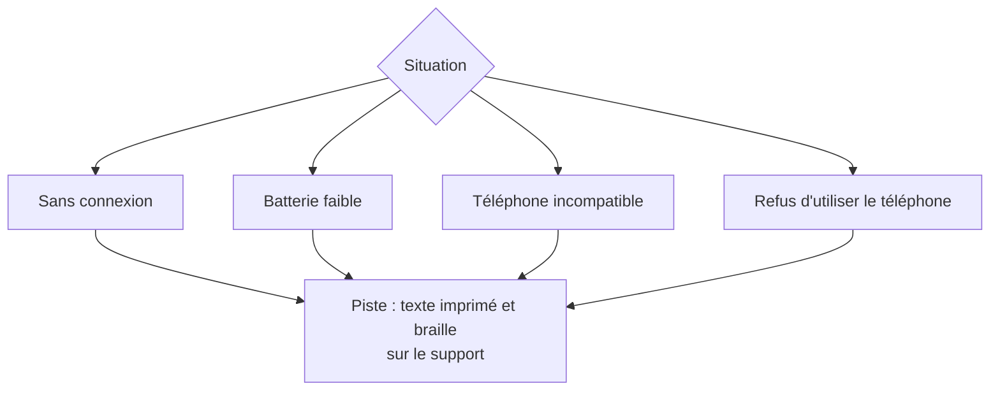

| Situation | Constat aujourd'hui | Piste |
|---|---|---|
| Sans connexion | Rien ne se charge : moteur, carte et polices viennent de services externes | Description brève sur le support physique |
| Batterie faible | Caméra + 3D consomment ; pas de mode économe | Contenu texte seul, sans caméra |
| Téléphone incompatible | Comportement du moteur non vérifié | Page de repli avec le texte |
| Refus du téléphone | Aucune alternative | Support imprimé : QR 3D, braille (à l'étude) |

### Parcours P4 : progression et récompense (US-10, US-11 ; V2)

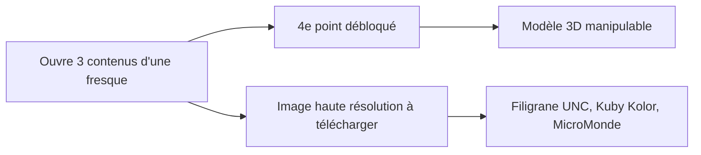

Non codé : aucune progression n'est enregistrée aujourd'hui (voir [TRD.md](TRD.md) § 3, « Données et contenus »). Dans la V1, le bouton lecture est disponible dès la reconnaissance de la fresque.

## 3. États des écrans clés

États de l'écran de scan (constatés dans `src/main.ts`, `src/ui/hud.ts`, `src/ui/panel.ts`, `src/ar/worldScene.ts`). Un schéma par élément : ils évoluent en parallèle, pas à la suite.

### 3.1 Scan : de l'ouverture à la détection

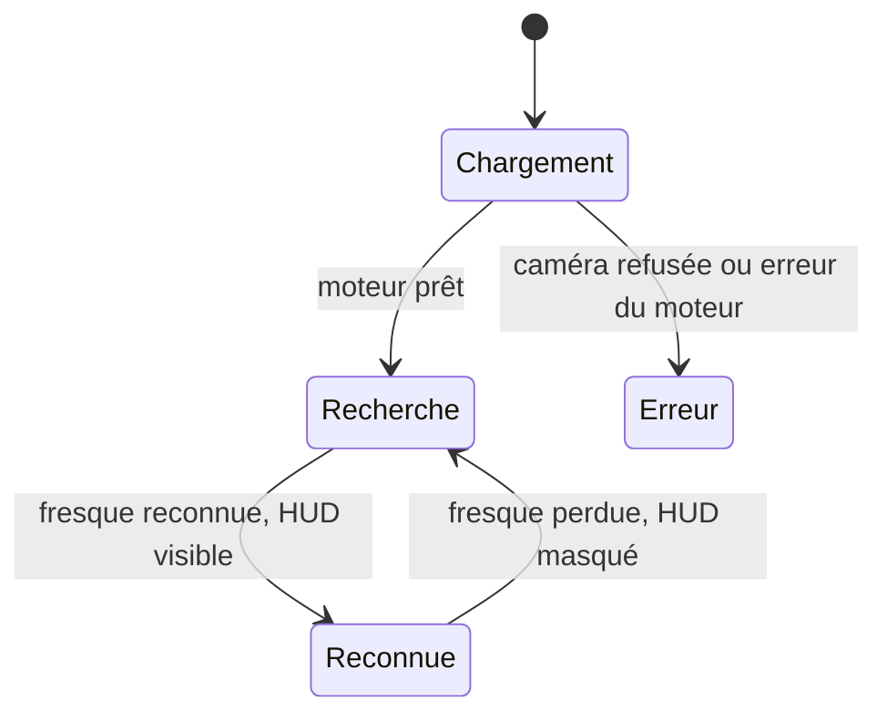

### 3.2 Modèle 3D

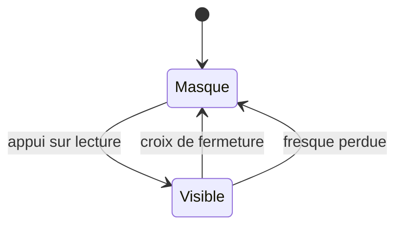

Quand le modèle est visible, le bouton lecture est caché et la croix de fermeture apparaît.

### 3.3 Panneau de contenu

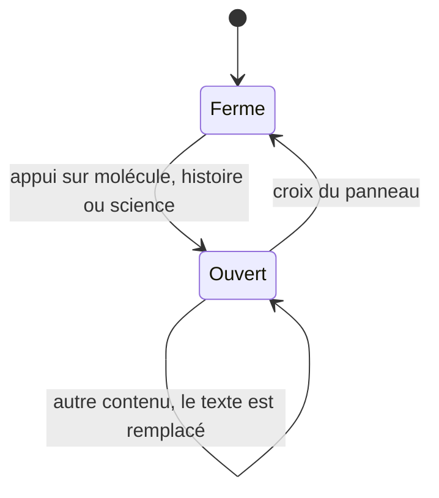

### 3.4 Audio

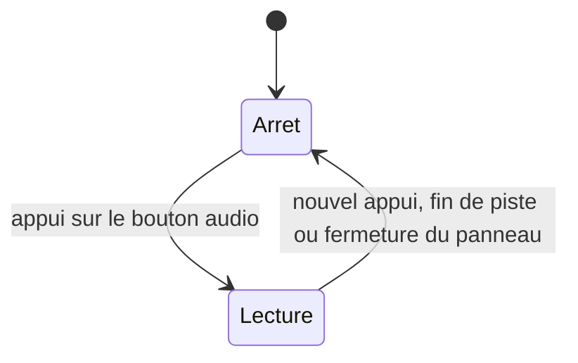

Règles lues dans le code :

- Fresque perdue : le HUD est masqué, le modèle est masqué, l'état « modèle révélé » est remis à zéro.
- Un panneau ouvert reste ouvert si la fresque est perdue : seule la croix du panneau le ferme.
- Fresque reconnue sans contenu défini : le HUD ne s'affiche pas.
- Bouton hors du champ (point d'ancrage derrière la caméra ou hors cadre) : masqué et non cliquable.

### 3.5 Échange à la détection de la fresque

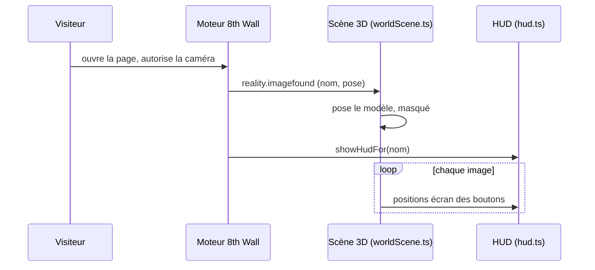

### 3.6 Échange à l'apparition du modèle puis à la perte de la fresque

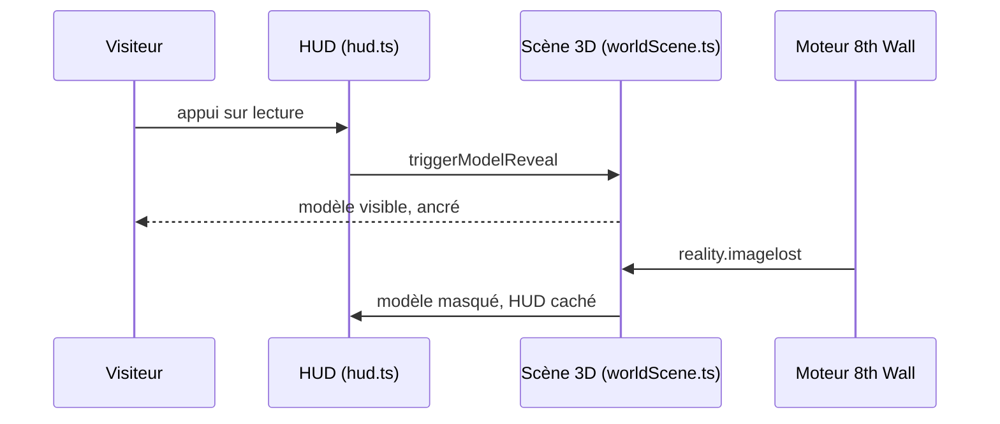

## 4. Desktop / mobile

| Point du parcours | Desktop | Mobile |
|---|---|---|
| Scan AR | Non conçu : caméra de bureau, pas de suivi de l'espace | Usage cible, validé sur Android / Chrome |
| Carte | Affichable ; non testé | Zoom au pincement, bouton de recentrage |
| Panneau de contenu | Non testé | Panneau plein écran |
| iPhone / Safari | — | Fonctionnement à confirmer |

## 5. Clavier et accessibilité du parcours

- Interface conçue pour le toucher. Tous les boutons sont des éléments `button` ou `a` avec une étiquette (`aria-label`).
- Aucune gestion du focus : après la fermeture d'un panneau, le focus n'est pas rendu au bouton d'origine. Non testé au clavier ni au lecteur d'écran.
- Le texte accompagne toujours l'audio : pas de contenu uniquement sonore.
- Cibles tactiles sous 44 px : croix de fermeture 3D (40 px) et croix du panneau (32 px). Voir NF-04 de [PRD.md](PRD.md).
- Braille sur les supports physiques : à l'étude. Une personne non voyante a besoin d'être accompagnée pour l'application.

## 6. Questions ouvertes

- Un panneau ouvert doit-il se fermer quand la fresque change ?
- Faut-il un deuxième bouton pour revenir au HUD sans fermer le panneau ?
