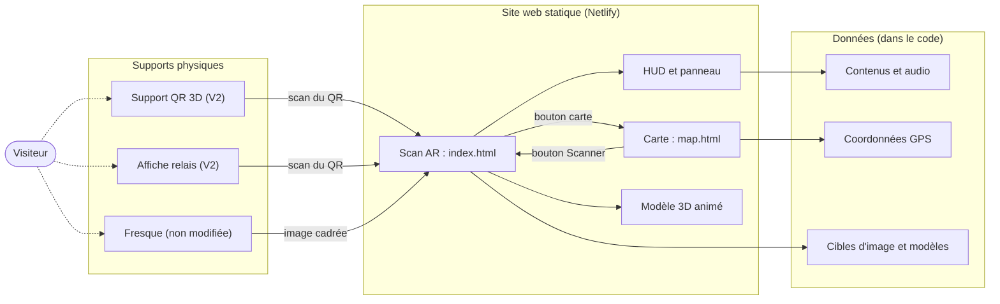

# MicroMonde, Vivez le vivant

**Parcours de découverte des fresques UNC — Dossier de conception**

Estelle Pochic - Léandre Vigouroux - Alexis Boutin

Statut : brouillon (à valider). Date : fin novembre 2026.
Volet : MMI, parcours Développement et application web (dispositifs interactifs).

Ce dossier raconte la conception. Il renvoie aux documents détaillés au lieu de les recopier : [PRD.md](PRD.md) (besoin), [APP-FLOW.md](APP-FLOW.md) (parcours), [TRD.md](TRD.md) (technique, données et contenus), [DESIGN-BRIEF.md](DESIGN-BRIEF.md) (design), [TESTS-UTILISATEURS.md](TESTS-UTILISATEURS.md) (tests). Les schémas renvoyés seront insérés dans la version Word.

## Glossaire

| Terme | Définition |
|---|---|
| Image target (cible d'image) | Image de référence, ici la photo de la fresque, que la caméra reconnaît |
| SLAM | Suivi de l'espace : le téléphone se repère dans son environnement pour garder un objet 3D en place pendant qu'on se déplace |
| WebAR | Réalité augmentée dans le navigateur, sans application |
| glTF / `.glb` | Format de fichier d'objet 3D |
| Draco | Compression des modèles 3D |
| HUD | Interface superposée à l'image de la caméra |
| Endémisme | Caractère d'une espèce vivant exclusivement dans une zone géographique donnée |
| Filigrane | Marque de traçabilité et de communication superposée à une image |
| Panneau (bottom sheet) | Panneau qui monte depuis le bas de l'écran |

## 1. Contexte et enjeux

- La commande *Micro-Mondes : Trajectoires du vivant* fait dialoguer art, science et numérique.
- Le campus de l'UNC accueille un parcours de fresques monumentales de Kuby Kolor : tortue marine, hibiscus, loriquet à tête bleue. Chaque fresque est associée à la représentation graphique de la molécule d'un élément caractéristique de l'espèce.
- Le projet est interdisciplinaire : MMI Stratégie de communication et UX Design (expérience vécue), MMI Développement et application web (dispositifs numériques, réalité augmentée, prototypes), LEA (récit, médiation, supports multilingues).
- Notre volet : concevoir et développer les dispositifs interactifs du parcours.
- Cadre : projet universitaire. L'artiste et l'UNC n'ont pas été informés du projet.

## 2. Besoin et cahier des charges

- But du produit : compléter l'exposition par un parcours interactif qui implique le visiteur.
- Objectifs, user stories, exigences fonctionnelles et non fonctionnelles, contraintes, périmètre par version : [PRD.md](PRD.md).
- Contraintes structurantes : aucune application à installer ; aucun QR code sur la fresque ; budget nul ; usage sur smartphone.

## 3. Choix de la technologie

Le parcours repose sur un **site web** et sur la **réalité augmentée dans le navigateur**, avec le moteur **8th Wall** et la bibliothèque 3D **Three.js**.

- Raison principale : le moteur reconnaît l'image de la fresque **et** suit l'espace. L'animal reste en place pendant que le visiteur en fait le tour, même si la fresque sort du cadre.
- Raison d'usage : aucune application à installer, ce qui répond à la commande.
- Raison de coût : moteur gratuit et auto-hébergeable, outils open source.
- Les pistes écartées (MindAR, Vuforia, solutions sans code) sont documentées dans [TRD.md](TRD.md) § 9.

## 4. Publics et usages

- Publics cités par la commande : étudiants de l'UNC, lycéens, enseignants-chercheurs, visiteurs extérieurs et touristes, familles. Tableau des besoins : [PRD.md](PRD.md) § 4.
- Usage cible : smartphone, debout devant la fresque, une main.

## 5. Note d'intention du dispositif

Réponses aux six questions de la commande.

| Question | Réponse |
|---|---|
| Pourquoi ce dispositif existe-t-il ? | Pour compléter l'exposition par un parcours interactif qui implique le visiteur |
| Que permet-il qu'une affiche ne permettrait pas ? | Voir l'animal en 3D sortir du mur et en faire le tour ; écouter ; situer les fresques sur une carte avec sa position |
| Que déclenche-t-il ? | Le scan de la fresque affiche l'interface ; le bouton central fait apparaître l'animal ; trois boutons ouvrent la molécule, l'histoire et le fait scientifique |
| Comment accompagne-t-il l'immersion ? | Modèle 3D animé et ancré dans l'espace réel ; interface discrète aux couleurs bois et nature ; audio prévu pour chaque contenu |
| Comment favorise-t-il la compréhension ? | Trois entrées distinctes par fresque ; le texte accompagne toujours l'audio ; la molécule est rattachée à l'espèce peinte |
| Comment s'intègre-t-il au parcours ? | La carte relie les fresques ; le parcours est libre ; la fresque n'est jamais modifiée, le QR est sur un support à côté |

## 6. Parcours et scénarios

- Carte des écrans, parcours P1 (première visite), P2 (depuis une affiche relais), P3 (mode dégradé), P4 (progression et récompense), états de l'écran de scan, séquence du scan : [APP-FLOW.md](APP-FLOW.md).

## 7. Ergonomie et interface

- Charte graphique (palette bois et nature, Fleur De Leah et Quicksand) : [DA.md](../DA.md).
- Composants du HUD et du panneau, tailles, contrastes mesurés : [DESIGN-BRIEF.md](DESIGN-BRIEF.md).
- Maquettes : wireframes Figma de la fiche projet.
- Figures : à insérer, images définitives à fournir.

## 8. Architecture

Schéma fonctionnel : dispositifs, interactions, échanges entre supports physiques et numériques, données utilisées.

- Parcours technique du visiteur (séquence navigateur, moteur, scène 3D, interface) : [APP-FLOW.md](APP-FLOW.md) § 3.
- Pile technique, modules, intégrations externes, décisions, risques : [TRD.md](TRD.md).
- Pas de base de données ni de serveur applicatif : [TRD.md](TRD.md) § 3, « Données et contenus ».

## 9. Contenus

Trois points d'information par fresque, cliquables sur l'image scannée :

| Contenu | Sujet |
|---|---|
| Molécule | La molécule associée à l'espèce par l'artiste |
| Histoire | Un conte, une légende, une anecdote ou un trait d'humour local |
| Fait scientifique | Un fait sur l'espèce, son comportement, ses particularités, son endémisme en Nouvelle-Calédonie |

- Chaque contenu a sa propre page, doublée en audio. Une seule page est affichée à la fois.
- Langues prévues : français et anglais pour les contenus scientifiques ; pour les légendes en langue kanak, versions française et anglaise et doublage en langue si possible (V2).
- Voix prévues : une même voix neutre pour les contenus scientifiques, ou un expert local de l'UNC ; pour les légendes, un accent local parodique ou une personne s'exprimant en langue kanak.
- **Version actuelle (V1)** : textes provisoires, contes générés par IA et étiquetés comme tels dans l'interface. Aucune source consultée ne rapporte de conte kanak sur la tortue, l'hibiscus ou le loriquet : ces textes sont des créations, pas des légendes traditionnelles. Détail et précautions : [CONTES-INSPIRATION.md](CONTES-INSPIRATION.md).
- **V2** : recherche de contenu, validation par les intervenants concernés, enregistrement audio.

## 10. Dispositif physique

D'après la fiche projet :

- Un QR code par fresque, sur un support à côté de l'œuvre. La fresque n'est en aucun cas modifiée.
- QR code imprimé en 3D, conçu comme une œuvre numérique à part entière : il fait le lien entre l'art plastique et l'art numérique.
- Les deux couleurs du QR sont obtenues avec deux plastiques différents, pas avec de la peinture, pour la durabilité.
- Thème de couleur par fresque : bleu pour la tortue, vert pour le loriquet, rouge pour l'hibiscus.
- Affiches sur le campus comme points de relais, pour découvrir le dispositif sans être près des fresques.
- **Extension à l'étude :** braille le long des panneaux, pour une description brève de l'œuvre et de l'espèce. Une personne non voyante devra être accompagnée pour l'application.
- **Point de vigilance :** l'accessibilité auditive est couverte par le texte qui double systématiquement l'audio ; le braille répond au handicap visuel.

## 11. Accessibilité et mode dégradé

| Situation (commande) | Réponse envisagée |
|---|---|
| Absence de connexion | Description brève sur le support physique (V2) |
| Faible batterie | Contenu texte sans caméra (V2) |
| Téléphone incompatible | Page de repli avec le texte (V2) |
| Personne ne souhaitant pas utiliser son téléphone | Support imprimé : QR 3D, braille (V2) |

- Aujourd'hui, l'application dépend du réseau (moteur, carte, polices). Voir [TRD.md](TRD.md) § 10.
- Le texte accompagne toujours l'audio.
- Cibles tactiles : la plupart ≥ 44 px ; deux croix de fermeture sont plus petites ([DESIGN-BRIEF.md](DESIGN-BRIEF.md) § 7).

## 12. Réalisation du prototype

- Version `0.3.0-beta`, code public, licence MIT, déployé sur Netlify.
- Trois fresques reconnues au scan, avec modèle 3D animé et ancré : tortue (2,4 Mo), loriquet (6,4 Mo), hibiscus (1,0 Mo).
- Carte Leaflet avec marqueurs, popup et position du visiteur.
- Quatre vidéos d'essai du 19/10/2026 (de 16 à 21 secondes, téléphone Android, navigateur Chrome) montrent le parcours : carte, scan, interface, panneau, modèle 3D.
- Validé sur Android / Chrome. iPhone / Safari : fonctionnement à confirmer.
- Point de départ du prototype : validation du suivi de l'espace en extérieur, sur mur, avec lumière changeante ([8thwall-image-target.md](8thwall-image-target.md)).
- Figures : à insérer.

## 13. Tests utilisateurs

Prototype testé avec la classe le 08/10/2026 (20 personnes, à l'UNC). Protocole, retours et synthèse : [TESTS-UTILISATEURS.md](TESTS-UTILISATEURS.md).

## 14. Équipe, coûts, maintenance

**Équipe.** Répartition relevée dans l'historique git (du 01/09 au 30/09/2026) :

| Personne | Travail |
|---|---|
| Alexis Boutin | Initialisation du projet, moteur de réalité augmentée, cibles d'image, déploiement, versions |
| Léandre Vigouroux | Réalisation des trois modèles 3D animés, classes CSS, direction artistique de l'interface, panneau et HUD, contenus de l'hibiscus |
| Estelle Pochic | Carte Leaflet : localisation des fresques, position du visiteur, accès depuis le scan |

**Coûts.** Budget : 0 €. Outils open source :

| Brique | Licence |
|---|---|
| Three.js | MIT |
| Leaflet | BSD-2-Clause |
| Vite | MIT |
| TypeScript | Apache-2.0 |
| 8th Wall (moteur) | Cœur MIT, module de suivi de l'espace sous licence binaire séparée et gratuite (d'après le README du projet) |
| Netlify | Formule gratuite, compte d'Alexis Boutin |

Hors budget : impression 3D des supports QR, à chiffrer si elle est réalisée.

**Maintenance.**

- Dépôt public sur GitHub. Le projet peut être copié (fork) et repris.
- Code et modèles 3D (réalisés par Léandre Vigouroux) sous licence MIT. Les fresques de Kuby Kolor, leurs reproductions (images des cibles) et les contenus ne sont pas couverts par cette licence.
- Site hébergé sur un compte Netlify personnel d'Alexis Boutin, déployé depuis la branche `main`.
- Dépendance au moteur de réalité augmentée, chargé depuis un CDN : [TRD.md](TRD.md) § 7.

## 15. Évolutions

### Fresque proposée : le champignon *Pisolithus albus*

- Espèce : champignon ectomycorhizien (champignon en symbiose avec les racines des plantes, via une structure externe aux cellules de la racine) endémique, *Pisolithus albus*. Il permet aux plantes calédoniennes de pousser sur des sols miniers toxiques.
- Interprétation graphique : le sol comme ligne d'horizon. Partie souterraine avec les racines et la symbiose entre champignon et plante ; partie en surface avec la plante dans le maquis calédonien, sol toxique aux métaux.
- Une source citée dans nos notes de travail traite de la mycorhization des sols métallifères de Nouvelle-Calédonie (non relue pour ce dossier).

### Fresque proposée : *Le Voyage*

*Proposition de l'équipe, dans le cadre d'un projet universitaire : l'artiste n'a pas été consulté. Titre : « Le Voyage ». Composition : à désigner.*

**Sujet.** Un navire qui amène les bagnards à Nouville.

**Dimension historique.**

- Le 2 septembre 1863, un décret de Napoléon III désigne la Nouvelle-Calédonie comme lieu de transportation (envoi de condamnés aux travaux forcés dans une colonie).
- Le 9 mai 1864, la frégate *Iphigénie* amène le premier convoi à Port-de-France, l'actuelle Nouméa.
- 75 convois entre 1864 et 1897, le dernier arrivant à Nouméa le 25 février 1897. Environ 21 630 condamnés immatriculés (estimation d'Alain Saussol) à 22 000 transportés. Plus de 4 000 déportés politiques, surtout des communards, et près de 4 000 relégués ont aussi été envoyés.
- En 1873, la frégate *La Virginie* quitte l'île d'Aix avec des communards, dont Louise Michel. La traversée dure environ quatre mois, dans des conditions éprouvantes.
- Lieu : le pénitencier de l'île Nou, aujourd'hui le quartier de Nouville. Une tour de guet, un quai de débarquement et des logements de gardiens subsistent. Le campus de l'UNC à Nouville est voisin.
- Fin : le gouverneur Feillet demande l'arrêt de la transportation en 1894. La fin officielle du bagne est prononcée en 1931 ; d'autres sources donnent 1922 ou 1924 pour la fermeture du pénitencier.
- Les chiffres varient selon les sources (une source donne 22 057 transportés, 3 960 déportés et 3 772 relégués). Ils viennent de sources secondaires ; l'ouvrage de référence cité est *L'Archipel des forçats* de Louis-José Barbançon.
- Sources : [Geneawiki](https://fr.geneawiki.com/wiki/Bagne_de_Nouvelle-Cal%C3%A9donie), [Académie d'outre-mer](https://www.academieoutremer.fr/images/files/20210927_1e21d357b22a4db5f743b53c93c42d64.pdf), [DENC, histoire de la Nouvelle-Calédonie](https://denc.gouv.nc/sites/default/files/documents/histoire_module2_chapitre15.pdf), [Outremers 360](https://outremers360.com/bassin-pacifique-appli/serie-a-la-decouverte-du-patrimoine-de-la-nouvelle-caledonie-le-bagne-de-nouville), [Musée de la Ville de Nouméa](https://www.noumea.nc/sites/default/files/lieux/musee-ville/5-ile-exil-terre-asile.pdf).

**Lien art et science.** La molécule choisie est la **cellulose**. Polymère formé d'unités de glucose liées entre elles, c'est le principal polysaccharide de la paroi des cellules végétales. Dans le bois, elle peut représenter environ la moitié de la masse, ses fibres étant enrobées d'une matrice de lignine et d'hémicelluloses qui les renforce. Le bois, c'est la nature mise en construction : la coque, les mâts, les ponts, la solidité du navire. Sources : [Encyclopædia Universalis](https://www.universalis.fr/encyclopedie/bois/2-composition-chimique/), [fiche Cellulose](https://franco.wiki/fr/Cellulose.html).

**Note d'intention proposée.** La tortue traverse l'océan en liberté ; le navire le traverse sous contrainte. Même océan, deux voyages. La solidité du bois qui porte les hommes est aussi celle qui les enferme : le navire dit la dureté du bagne, de la traversée jusqu'à Nouville.

**Place dans le parcours.** D'après la fiche projet, cette fresque apparaît sur la carte du visiteur quand il a terminé MicroMonde : un nouveau parcours, un nouveau thème (le bagne), un nouveau lieu, l'IUT.

### Pistes pour la suite

- Contenus recherchés, enregistrements audio, langues, progression, récompense (image haute résolution de la fresque avec filigrane UNC – Kuby Kolor – MicroMonde).
- Marqueurs de la carte en croix de carte au trésor.
- Ambiance sonore et animation du monde microscopique, demandées par la commande.

## 16. Conclusion

MicroMonde complète l'exposition des fresques de l'UNC par un parcours interactif, accessible depuis le téléphone, sans application. Trois fresques sont reconnues, leurs animaux apparaissent en 3D, une carte relie le tout. La suite porte sur les contenus, l'audio, la progression et les deux fresques proposées.

## Annexes

- Annexe A : figures (à fournir).
- Annexe B : grille d'observation des tests ([TESTS-UTILISATEURS.md](TESTS-UTILISATEURS.md) § 3).
- Annexe C : matière d'inspiration pour les contes ([CONTES-INSPIRATION.md](CONTES-INSPIRATION.md)).
