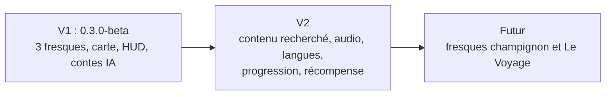

# PRD — MicroMonde

Statut : brouillon (à valider)
Version du produit décrite : `0.3.0-beta` (30/09/2026). Rédaction : 26/10/2026. Rendu visé : fin novembre 2026.
Sources : `Commande_MMI_Micro-mondes.pdf`, dossier de l'artiste *Trajectoire Micro-monde V2* (Kuby Kolor), `Fiche Projet Micro Monde.docx`, [README](../README.md), [DA.md](../DA.md), code du dépôt, `git log`, vidéos d'essai du 19/10/2026.

Légende de la colonne **État** : *Livré* = vu dans le code et en vidéo ; *Partiel* ; *Prévu V2* ; *Futur*.

## 1. But du produit

L'Université de la Nouvelle-Calédonie (UNC) accueille un parcours de fresques monumentales de l'artiste Kuby Kolor : une tortue marine, un hibiscus et un loriquet à tête bleue. MicroMonde complète cette exposition par un parcours interactif, accessible depuis le téléphone, qui implique le visiteur : il scanne les fresques, les explore, les écoute et les comprend. Aucune application n'est à installer. Le parcours respecte l'œuvre : aucun QR code sur la fresque, les supports sont posés à côté.

## 2. Objectifs

| ID | Objectif | Mesure de succès | État |
|---|---|---|---|
| O-01 | Faire « prendre vie » chaque fresque en réalité augmentée, sans application | 3 fresques sur 3 reconnues au scan sur Android / Chrome (vidéos du 19/10) | Livré |
| O-02 | Donner trois portes d'entrée par fresque : molécule, histoire, fait scientifique | 3 contenus ouvrables par fresque (textes provisoires) | Partiel |
| O-03 | Relier les fresques par une carte | 3 marqueurs, popup avec lien vers le scan | Livré |
| O-04 | Faire sortir l'animal du mur : modèle 3D ancré dans l'espace, visiteur libre d'en faire le tour | Modèle stable pendant un déplacement (vidéos) | Livré |
| O-05 | Coût nul et projet reproductible | Logiciels open source, hébergement gratuit, licence libre MIT ajoutée le 26/10 (fichier `LICENSE`) | Livré |
| O-06 | Donner envie de tout parcourir : progression, récompense | Voir F-14, F-15 | Prévu V2 |

Retours de la séance du 08/10/2026 (20 personnes) : l'interface est assez claire et les modèles 3D ont marqué ; aucun retour sur l'apprentissage ni sur la molécule. Détail : [TESTS-UTILISATEURS.md](TESTS-UTILISATEURS.md).

## 3. Non-objectifs

- Application native ou installation d'une application tierce.
- Compte utilisateur, connexion, serveur applicatif.
- Marquage de la fresque elle-même (QR sur l'œuvre interdit).
- Guidage pas à pas ou ordre de visite imposé : le parcours est libre.
- Peinture des nouvelles fresques proposées : ce sont des propositions.
- Contenu scientifique et culturel validé en V1 : les textes sont des contes générés par IA, provisoires.

## 4. Utilisateurs

Publics cités par la commande.

| Public | Contexte | Besoin principal (d'après les documents) |
|---|---|---|
| Étudiants de l'UNC | Passent chaque jour devant les fresques | Découverte rapide, sans installer, sur smartphone |
| Lycéens | Visites, journées portes ouvertes | Expérience ludique et courte |
| Enseignants-chercheurs | Connaissent l'espèce | Contenu scientifique crédible (voix d'expert envisagée) |
| Visiteurs extérieurs, touristes | Découvrent le campus et le territoire | Repères, carte, contenu multilingue (V2) |
| Familles | Tous âges | Interaction simple, 3D, audio |
| Personnes non voyantes | Autonomie limitée sur l'application | Braille sur les supports (à l'étude), accompagnement |
| Équipe contenu / mainteneur | Rédige et remplace textes et audio | Contenu séparé du code (voir F-18) |

## 5. User stories

| ID | En tant que | Je veux | Afin de | Priorité |
|---|---|---|---|---|
| US-01 | Visiteur | ouvrir le site depuis un QR code ou une adresse, sans installer | commencer tout de suite | P1 |
| US-02 | Visiteur | voir toutes les fresques sur une carte | choisir où aller | P1 |
| US-03 | Visiteur | scanner une fresque avec ma caméra | déclencher l'expérience | P1 |
| US-04 | Visiteur | ouvrir un contenu (molécule, histoire, science) et le lire | comprendre l'espèce | P1 |
| US-05 | Visiteur | écouter le contenu | ne pas lire debout devant un mur | P1 |
| US-06 | Visiteur | faire apparaître l'animal en 3D et tourner autour | vivre l'œuvre | P1 |
| US-07 | Visiteur | passer de la carte au scan et inversement | enchaîner les fresques dans l'ordre de mon choix | P1 |
| US-08 | Visiteur | que le texte accompagne toujours l'audio | comprendre sans pouvoir écouter | P1 |
| US-09 | Visiteur | lire dans ma langue (français, anglais, kanak) | comprendre | P2 |
| US-10 | Visiteur | retrouver ce que j'ai déjà visité | suivre ma progression | P2 |
| US-11 | Visiteur | recevoir une récompense à la fin d'une fresque | garder un souvenir et en parler | P2 |
| US-12 | Visiteur sans connexion ou sans téléphone compatible | une alternative | que le parcours reste utile | P2 |
| US-13 | Équipe contenu | remplacer textes et audio sans toucher au code | publier le contenu validé | P1 |

## 6. Exigences fonctionnelles

| ID | Exigence | User story | Critère d'acceptation | État |
|---|---|---|---|---|
| F-01 | Le site est une application web statique accessible par adresse ou QR | US-01 | Étant donné un téléphone avec navigateur, quand j'ouvre l'adresse, alors la page de scan se charge sans installation | Livré (QR physique non produit) |
| F-02 | La carte affiche un marqueur par fresque, avec popup (nom + bouton « Scanner ») | US-02 | Étant donné la carte, quand je touche un marqueur, alors un popup affiche le nom et le bouton « Scanner » | Livré |
| F-03 | La carte affiche ma position et un bouton de recentrage ; si la géolocalisation est refusée, la carte reste utilisable | US-02 | Étant donné l'autorisation accordée, quand ma position arrive, alors un point apparaît et le bouton de recentrage devient visible | Livré |
| F-04 | Le scan reconnaît chacune des 3 fresques et n'affiche qu'une cible à la fois | US-03 | Étant donné une fresque cadrée, quand elle est reconnue, alors le HUD de cette fresque s'affiche et rien d'une autre fresque | Livré |
| F-05 | Le HUD affiche quatre boutons ancrés sur l'image : molécule, histoire, science, lecture 3D | US-04, US-06 | Étant donné une fresque reconnue, quand je bouge le téléphone, alors les boutons suivent leur point d'ancrage et se masquent hors champ | Livré |
| F-06 | Un panneau affiche titre, texte, mention IA, crédits, avec fermeture | US-04, US-08 | Étant donné un bouton de contenu, quand je le touche, alors un seul panneau s'ouvre avec le texte | Livré |
| F-07 | Le panneau permet de lancer et d'arrêter l'audio du contenu | US-05 | Étant donné un panneau ouvert, quand je touche le bouton audio, alors la piste démarre ; une seconde pression l'arrête | Partiel : bouton présent, aucun fichier audio fourni |
| F-08 | Le modèle 3D reste caché jusqu'à l'appui sur le bouton central, reste ancré dans l'espace, se ferme par une croix | US-06 | Étant donné une fresque reconnue, quand j'appuie sur lecture, alors l'animal apparaît et reste en place pendant que je tourne autour | Livré |
| F-09 | Le scan donne accès à la carte, la carte donne accès au scan | US-07 | Étant donné l'une des deux pages, quand je touche le bouton de liaison, alors l'autre page s'ouvre | Livré |
| F-10 | Les crédits de l'équipe s'affichent sur la carte et dans le panneau | — | Étant donné la carte ou un panneau, alors les rôles et noms sont visibles | Livré |
| F-11 | Chaque contenu porte la mention « généré à l'aide de l'IA » | US-04 | Étant donné un panneau ouvert, alors la mention apparaît sous le texte | Livré |
| F-12 | Les contenus sont remplaçables sans toucher à la logique (dossier `src/content/`, audio dans `public/assets/audio/`) | US-13 | Étant donné un texte validé, quand je modifie `fresques.ts`, alors le panneau l'affiche au rechargement | Livré |
| F-13 | Chaque contenu existe en français et en anglais ; les légendes kanak ont une version en langue si possible | US-09 | Étant donné un choix de langue, alors texte et audio changent | Prévu V2 |
| F-14 | La progression est mémorisée dans le navigateur ; un 4e point se débloque après les trois contenus | US-10 | Étant donné trois contenus ouverts, alors un point final distinct apparaît, même après rechargement | Prévu V2 |
| F-15 | Une image haute résolution de la fresque, avec filigrane UNC – Kuby Kolor – MicroMonde, se télécharge en récompense | US-11 | Étant donné une fresque terminée, quand je demande la récompense, alors l'image se télécharge | Prévu V2 |
| F-16 | Les marqueurs de la carte sont des croix de carte au trésor | US-02 | Étant donné la carte, alors chaque fresque est une croix | Prévu V2 (marqueurs classiques aujourd'hui) |
| F-17 | Un mode dégradé couvre l'absence de connexion, la batterie faible, le téléphone incompatible et le refus du téléphone | US-12 | Voir [APP-FLOW.md](APP-FLOW.md) § 2, parcours P3 | Prévu V2 |

## 7. Exigences non fonctionnelles

| ID | Catégorie | Exigence | État |
|---|---|---|---|
| NF-01 | Compatibilité | Fonctionne sur Android / Chrome (validé en vidéo). iPhone / Safari : fonctionnement à confirmer | Partiel |
| NF-02 | Sécurité | Accès caméra en HTTPS uniquement. En-tête `Permissions-Policy: camera=(self)` sur Netlify | Livré |
| NF-03 | Vie privée | Aucun compte, aucun serveur applicatif, aucune donnée envoyée par l'application. La position est lue par le navigateur et n'est pas stockée. Requêtes vers des tiers : fonds de carte OpenStreetMap, Google Fonts, CDN jsDelivr (moteur 8th Wall) | Livré |
| NF-04 | Accessibilité | Le texte est toujours présent avec l'audio. Cibles tactiles : HUD 56 px, bouton 3D 64 px, audio 56 px, carte 48 px, mais croix de fermeture du 3D 40 px et croix du panneau 32 px, sous le seuil de 44 px | Partiel |
| NF-05 | Performance | Poids des modèles : loriquet 6,4 Mo, tortue 2,4 Mo, hibiscus 1,0 Mo (format glTF compressé Draco). Temps de chargement non mesuré | À mesurer |
| NF-06 | i18n | Interface en français. Anglais et kanak prévus | Prévu V2 |
| NF-07 | Coût | 0 € : logiciels open source, hébergement Netlify gratuit | Livré |
| NF-08 | Maintenabilité | Couleurs uniquement dans `src/ui/variables.css` (règle de [DA.md](../DA.md)). Contenus dans `src/content/` | Livré |
| NF-09 | Disponibilité | Dépend de trois services externes : Netlify, jsDelivr, OpenStreetMap. Sans réseau, rien ne fonctionne | Risque connu |

## 8. Contraintes

| ID | Contrainte | Origine |
|---|---|---|
| C-01 | Aucune application tierce à installer | Client (projet) |
| C-02 | Rien sur la fresque : le QR va sur un support à côté | Projet (fiche projet) |
| C-03 | Connexion 4G ou wifi disponible sur le campus | Client |
| C-04 | HTTPS obligatoire pour la caméra | Technique |
| C-05 | Rendu de la commande : fin novembre 2026 | Client |
| C-06 | Budget nul, outils open source | Équipe |
| C-07 | Fresques existantes : tortue, hibiscus, loriquet à tête bleue | Client |
| C-08 | La commande demande au moins deux nouvelles œuvres : fresque du champignon, fresque *Le Voyage* (navire du bagne), toutes deux proposées | Commande |
| C-09 | Usage mobile uniquement (zoom au pincement, pas de bouton +/− sur la carte) | Technique |
| C-10 | Récits kanak : aucune source ne dit qui peut les raconter ou les adapter. Les placeholders sont des créations, étiquetées comme telles | Légale et culturelle ([CONTES-INSPIRATION.md](CONTES-INSPIRATION.md) § 4) |
| C-11 | Projet universitaire : l'artiste et l'UNC n'ont pas été informés du projet | Équipe |

## 9. Périmètre par version

| Version | Contenu |
|---|---|
| V1 (livrée) | O-01 à O-05 ; F-01 à F-12 (F-07 sans fichier audio) ; contenus = contes générés par IA |
| V2 | F-07 (audio réel), F-13 à F-17 ; contenus recherchés et validés ; supports physiques (QR 3D, braille à l'étude) ; correction des cibles tactiles (NF-04) ; amélioration du suivi de l'image (retours de la classe, [TESTS-UTILISATEURS.md](TESTS-UTILISATEURS.md) § 6) |
| Futur | Fresque du champignon *Pisolithus albus* ; fresque *Le Voyage* ; ambiance sonore ; animation du monde microscopique ; goodie final : nouveau parcours |

Piste à décider : faciliter la prise de photo avec le modèle 3D, observée pendant la séance du 08/10/2026.

## 10. Questions ouvertes

- Qui rédige et enregistre les contenus de la V2 ?
- iPhone / Safari : le parcours fonctionne-t-il ? À confirmer.
