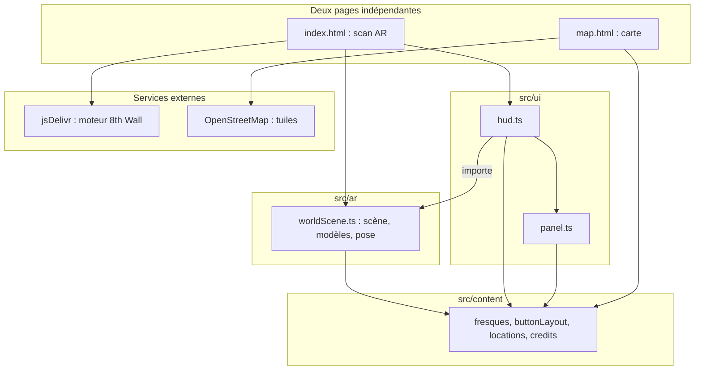

# TRD — MicroMonde

Statut : brouillon (à valider)
Couvre : F-01 … F-17, NF-01 … NF-09 de [PRD.md](PRD.md). Inclut le modèle de données (§ 3, « Données et contenus »).
Sources : code `0.3.0-beta`, `package.json`, `package-lock.json`, `netlify.toml`, [README](../README.md), [8thwall-image-target.md](8thwall-image-target.md), `git log`.

## 1. Stack

| Couche | Choix | Version | Raison |
|---|---|---|---|
| Bundler | Vite | 8.2.2 | Sortie statique, hébergement direct sur Netlify |
| Langage | TypeScript | 6.0.3 | Projet destiné à grossir (3 fresques, progression) |
| Moteur AR | 8th Wall (moteur binaire, xrextras, landing-page), chargé par balises `script` depuis jsDelivr | `@1` (version majeure flottante) | Reconnaissance d'image **et** suivi de l'espace (SLAM) dans le navigateur, sans application. Moteur gratuit et auto-hébergeable depuis le 28/02/2026 d'après le README |
| Rendu 3D | Three.js (+ `GLTFLoader`, `DRACOLoader`) | 0.185.1 | Intégré au moteur 8th Wall |
| Modèles | glTF binaire (`.glb`) compressé Draco, décodeur local dans `public/draco/` | — | Poids réduit, pas de CDN pour le décodeur |
| Carte | Leaflet + tuiles OpenStreetMap | 1.9.4 | Carte simple, sans clé d'API |
| HTTPS en développement | `@vitejs/plugin-basic-ssl` | 2.3.0 | La caméra exige un contexte sécurisé |
| Hébergement | Netlify, formule gratuite, compte personnel d'Alexis Boutin, déploiement depuis la branche `main` | Node 24 au build | Coût nul, HTTPS automatique |
| Polices | Google Fonts : Fleur De Leah, Quicksand | — | Voir [DA.md](../DA.md) |

## 2. Architecture

- **Pages** : deux pages séparées. La carte ne charge jamais le moteur AR.
- **AR** : seul module qui touche Three.js et le moteur. Il ne connaît pas le DOM.
- **UI** : déplace des éléments du DOM. `hud.ts` appelle `worldScene.ts`, jamais l'inverse. Le seul lien est un rappel de positions d'écran (`setButtonPositionListener`).
- **Données** : textes, audio, positions des boutons, coordonnées GPS, crédits. Sans base de données, ni progression enregistrée.

## 3. Modules et responsabilités

| Module / dossier | Responsabilité | Dépend de |
|---|---|---|
| `index.html` | Page de scan : canvas caméra, HUD, panneau, bouton carte, scripts du moteur | CDN jsDelivr |
| `map.html` | Page carte : conteneur, bouton « Scanner une fresque », crédits, recentrage | OSM |
| `src/main.ts` | Entrée du scan : enregistre les 3 cibles, assemble les modules du moteur | `worldScene`, `hud`, `panel` |
| `src/ar/worldScene.ts` | Charge les modèles, pose sur `imagefound`, anime, projette les boutons à l'écran | Three.js, `buttonLayout` |
| `src/ui/hud.ts` | 4 boutons ancrés, bouton 3D, croix 3D | `worldScene`, `panel`, `fresques` |
| `src/ui/panel.ts` | Panneau de contenu et audio unique | `fresques`, `credits` |
| `src/ui/credits.ts` | Affiche les crédits | `content/credits` |
| `src/ui/variables.css` | **Seule source** des couleurs et polices | — |
| `src/content/` | `fresques.ts` (textes, audio), `buttonLayout.ts` (offsets), `locations.ts` (GPS), `credits.ts` | — |
| `src/map/map.ts` | Marqueurs, popups, position de l'utilisateur | Leaflet, `locations` |
| `image-targets/` | Une cible par fresque : JSON, image, recadrage, miniature, luminance | moteur |
| `src/assets/models/` | 3 modèles `.glb`, réalisés par Léandre Vigouroux | — |
| `public/draco/` | Décodeur Draco local | — |
| `src/progress/` | Dossier vide : progression prévue | — |
| `netlify.toml` | Build, en-tête `camera=(self)` | Netlify |

### Données et contenus

Application sans base de données. Les données sont des constantes TypeScript, des fichiers statiques et, en V2, un stockage local dans le navigateur.

**Clé commune.** La clé d'une fresque est la même dans tout le projet : nom de la cible, contenus, positions des boutons, coordonnées, modèle. Elle a été renommée de `poc-peruche` en `poc-loriquet` le 26/10/2026.

| Clé | Fresque | Modèle | Animations jouées |
|---|---|---|---|
| `poc-tortue` | Tortue marine | `poc-turtlev2.glb` | Nage (vitesse 0,5) et lumière de l'eau |
| `poc-loriquet` | Loriquet à tête bleue | `poc-parrotv2.glb` | Vol (vitesse 1,25) |
| `poc-hibiscus` | Hibiscus | `Hibiscus_lowpoly.glb` | Rotations et déplacements, images 0 à 160 à 24 i/s, sans la piste d'échelle |

**Entités.**

| Entité | Stockage | Champs | Règle |
|---|---|---|---|
| Contenu | `src/content/fresques.ts` (`FRESQUE_CONTENT`) | `type` (`molecule`, `histoire`, `science`), `text`, `audioUrl` | Trois contenus par fresque. Libellés communs : `CONTENT_TITLES`, `CONTENT_NOTICE` (mention IA). Aucun fichier audio fourni |
| Emplacement | `src/content/locations.ts` | `key`, `name`, `lat`, `lng`, `available` | `available` à `false` : marqueur grisé, pas de lien vers le scan |
| Disposition des boutons | `src/content/buttonLayout.ts` | Décalage `x`, `y` par bouton | Unités locales de l'image ; réglés à l'œil sur la fresque ; valeurs propres à chaque fresque dans `CUSTOM_OFFSETS` |
| Cible d'image | `image-targets/<clé>.json` et images associées | `name`, `imagePath` | `name` égal à la clé ; `imagePath` remplacé au démarrage par l'URL empaquetée par Vite (`src/main.ts`) |
| Crédits | `src/content/credits.ts` | `role`, `name` | Affichés sur la carte et dans le panneau |
| Progression (V2) | `localStorage` prévu | fresque, contenus ouverts, terminée | Rien n'est stocké aujourd'hui (aucun appel à `localStorage` dans `src/`) ; `src/progress/` est vide |

**Règles d'intégrité.**

| ID | Règle | Où elle est appliquée |
|---|---|---|
| R-01 | Une cible reconnue sans contenu n'affiche pas le HUD | `showHudFor` dans `src/ui/hud.ts` |
| R-02 | Une seule fresque affichée à la fois | `hideAllExcept` dans `src/ar/worldScene.ts` |
| R-03 | La clé est identique dans les cibles, contenus, positions, emplacements et modèles | Convention, aucun contrôle automatique |
| R-04 | Aucune couleur en dur hors `variables.css` | Convention du projet ([DA.md](../DA.md)) |

**Contenu : cycle de vie.** Texte provisoire (conte généré par IA) puis texte recherché et validé (V2). Le libellé « Histoire traditionnelle » présente un texte généré comme traditionnel : à corriger (voir [CONTES-INSPIRATION.md](CONTES-INSPIRATION.md) § 0).

**Progression (V2).** Stockage local par appareil, quelques dizaines d'octets par fresque. Si les données sont absentes ou corrompues, repartir d'une progression vide. L'état « parcours complet » se déduit : toutes les fresques terminées.

## 4. Intégrations externes

| Service | Usage | Authentification | Limites, erreurs connues |
|---|---|---|---|
| jsDelivr (8th Wall `engine-binary`, `xrextras`, `landing-page`) | Moteur AR | Aucune | Version majeure `@1` non épinglée, pas de contrôle d'intégrité. Le module SLAM est un binaire sous licence séparée (gratuite, d'après le README). Sans réseau : rien ne démarre |
| OpenStreetMap (tuiles) | Fond de carte | Aucune | Politique d'usage des tuiles à respecter : non vérifiée ici |
| Google Fonts | Polices | Aucune | Sans réseau : polices de repli |
| Géolocalisation du navigateur | Position sur la carte (`watchPosition`, haute précision) | Autorisation de l'utilisateur | Refus : avertissement en console, carte utilisable |
| Netlify | Hébergement statique | Compte d'Alexis Boutin | Formule gratuite ; le site dépend de ce compte |

Séquence du scan : voir [APP-FLOW.md](APP-FLOW.md) § 3.

## 5. Exigences techniques

| ID | Exigence | Lien PRD | Vérification |
|---|---|---|---|
| T-01 | Le build produit un site statique avec les deux pages `index.html` et `map.html` | F-01 | `npm run build` (compile TypeScript puis Vite) |
| T-02 | Le serveur de développement tourne en HTTPS, accessible sur le réseau local | NF-02 | `npm run dev -- --port 8888`, page ouverte sur le téléphone (voir README) |
| T-03 | Netlify envoie `Permissions-Policy: camera=(self)` | NF-02 | En-têtes de la réponse du site |
| T-04 | Trois cibles enregistrées ; une seule fresque affichée à la fois | F-04 | Console : `[target-logger] <nom> trouvé / perdu`, un modèle visible à la fois |
| T-05 | Le modèle est posé une fois sur `imagefound` puis suivi dans l'espace | F-08 | Se déplacer autour : le modèle reste en place (vidéos du 19/10) |
| T-06 | Les boutons du HUD suivent leur point d'ancrage par projection 3D → écran et se masquent hors champ | F-05 | Déplacer le téléphone : boutons suivis, masqués hors cadre |
| T-07 | Le décodeur Draco est servi localement | NF-05 | Requêtes réseau vers `/draco/` |
| T-08 | Aucune couleur en dur hors `variables.css` | NF-08 | Recherche des codes couleur dans `src/` : seules les lignes de `variables.css` sortent (relevé le 26/10) |
| T-09 | Textes et audio vivent dans `src/content/fresques.ts` et `public/assets/audio/` | F-12 | Modifier un texte : le panneau l'affiche au rechargement |
| T-10 | La position utilisateur est suivie en continu, sans bloquer la carte en cas de refus | F-03 | Refuser l'autorisation : la carte reste utilisable |
| T-11 | Un fichier `LICENSE` (MIT) couvre le code | O-05 | Fichier présent à la racine |

## 6. Gestion des erreurs et états

| Situation | Comportement actuel |
|---|---|
| Moteur en cours de chargement | Écran de chargement du moteur (`XRExtras.Loading`) |
| Caméra refusée, erreur du moteur | Message du moteur (`XRExtras.RuntimeError`) |
| Appareil non pris en charge | Module `LandingPage` du moteur : comportement exact **à vérifier** |
| Fresque reconnue sans contenu | HUD non affiché |
| Modèle pas encore chargé au moment de l'appui sur lecture | La demande est gardée, appliquée à la fin du chargement |
| Animation introuvable dans un modèle | Avertissement en console, modèle affiché sans cette animation |
| Fichier audio absent ou illisible | Avertissement en console, aucun message à l'écran |
| Géolocalisation refusée | Avertissement en console, carte utilisable sans le point |
| Réseau absent | Aucun traitement : rien ne se charge |

## 7. Sécurité et vie privée

- Le flux caméra est traité dans le navigateur par le moteur. Le code de l'application n'envoie ni image ni position. Le comportement interne du moteur tiers n'est pas audité.
- Aucun compte, aucun cookie posé par l'application, aucun stockage local (la progression n'existe pas encore).
- **Risque : chaîne d'approvisionnement.** Les trois scripts du moteur viennent d'un CDN, version majeure flottante, sans attribut `integrity`. Une mise à jour du moteur peut casser ou modifier le site. Pistes : épingler la version exacte avec contrôle d'intégrité, ou héberger les fichiers (le README indique que le moteur est auto-hébergeable).
- Requêtes vers des tiers : jsDelivr, OpenStreetMap, Google Fonts. Ces services voient l'adresse IP du visiteur.

## 8. Qualité

- Lint : aucun linter configuré.
- Build : `npm run build`
- Tests : aucun framework de test.
- Vérification navigateur : téléphone sur le réseau local (procédure du README) et site Netlify. Validé sur Android / Chrome. iPhone / Safari : fonctionnement à confirmer.
- CI : le workflow GitHub Actions a été supprimé le 04/09/2026. Le README qui décrivait une CI a été corrigé le 26/10/2026.

## 9. Décisions

| Date | Décision | Alternatives écartées | Raison |
|---|---|---|---|
| 2026-09-01 | 8th Wall remplace MindAR | MindAR (suivi d'image seul, le modèle décroche si la fresque sort du cadre) ; Vuforia (plugin Unity, caméra inactive en WebGL) ; solutions sans code (Artivive, Actionbound, STQRY, Loquiz) | Faire le tour du modèle exige un suivi de l'espace ; aucune application à installer |
| 2026-09-01 | Vite + TypeScript | — | Sortie statique, projet évolutif |
| 2026-09-04 | Workflow GitHub Actions supprimé | — | Raison non écrite dans l'historique |
| 2026-09-29 | Carte Leaflet dans une page séparée | Carte dans la page AR | Ne pas charger le moteur AR sur la carte |
| 2026-10-26 | Hébergement Netlify, compte personnel d'Alexis Boutin, formule gratuite | — | Coût nul. Le projet reste forkable |
| 2026-10-26 | Licence MIT pour le code et pour les trois modèles 3D de Léandre Vigouroux | Aucune licence | Fork et réutilisation permis. Les fresques de Kuby Kolor, leurs reproductions (images des cibles) et les contenus restent exclus (voir § 10) |
| 2026-10-26 | Contenus provisoires = contes générés par IA, étiquetés comme tels | Textes présentés comme légendes traditionnelles | Aucun conte kanak sourcé sur les trois sujets ([CONTES-INSPIRATION.md](CONTES-INSPIRATION.md)) |
| 2026-10-26 | Molécules : description de l'artiste conservée ; écarts relevés par les recherches signalés en note | Réécriture par l'équipe | Le choix scientifique relève de l'artiste ; la note cite les sources ([FICHE-REALISATION.md](FICHE-REALISATION.md), note 1) |
| 2026-10-26 | Modèle de données fusionné dans ce document (§ 3) | Document séparé | Application sans base de données ; évite les doublons |
| 2026-10-26 | Le QR physique mène à la page de scan | Entrée par la carte | Décision de l'équipe ; la carte reste accessible par le bouton du scan |
| 2026-10-26 | Clé `poc-peruche` renommée `poc-loriquet` (fichiers, cibles, code, carte) | Garder « perruche » | Nom de l'espèce selon l'artiste : loriquet à tête bleue |

## 10. Dette et risques connus

| Risque | Gravité | Effort | Conséquence si ignoré |
|---|---|---|---|
| Moteur chargé sans version exacte ni contrôle d'intégrité | Moyenne | Faible | Site cassé ou modifié par une mise à jour distante |
| Dépendance totale au réseau (moteur, carte, polices) | Haute | Élevée | Aucun mode dégradé |
| iPhone / Safari : fonctionnement à confirmer | Haute | Faible | Une partie des visiteurs peut être bloquée |
| Aucun test automatisé, aucun linter | Moyenne | Moyenne | Régressions non détectées |
| Licence MIT et œuvres protégées dans le même dépôt (images des fresques dans `image-targets/`) | Moyenne | Faible | Une réutilisation du dépôt pourrait copier des œuvres de l'artiste. Ces images sont exclues de la licence (README) |
| Les images des fresques sont dans un dépôt public ; l'artiste et l'UNC n'ont pas été informés (projet universitaire) | Moyenne | Faible | Un retrait de ces images peut être demandé |
| Cibles tactiles sous 44 px (croix 3D 40 px, croix du panneau 32 px) | Faible | Faible | Confort d'usage |
| Fichiers audio absents | Moyenne | Selon le contenu | Bouton audio sans effet |
| Compte Netlify personnel | Faible | Faible | Le site disparaît si le compte ferme |

## 11. Questions ouvertes

- Faut-il épingler la version du moteur 8th Wall avec contrôle d'intégrité avant le rendu ?
- iPhone / Safari : le parcours fonctionne-t-il ? À confirmer avant le rendu.
